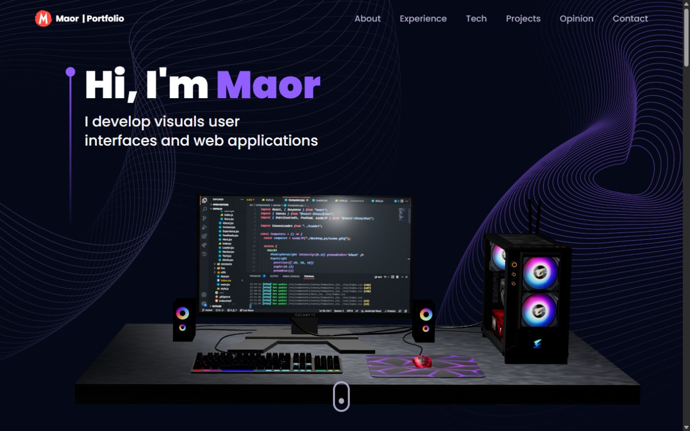
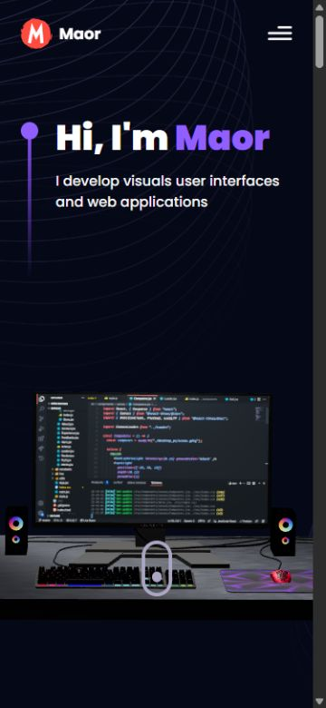

# Maor Netzer | 3D Developer Portfolio

A personal developer portfolio presenting selected full-stack projects, work experience, and technical skills through an interactive 3D interface.

[Live Demo](https://maornetzer.onrender.com) · [GitHub Repository](https://github.com/maornetzer9/3D_Portfolio)


## Overview

This portfolio gives recruiters and technical reviewers a focused view of my development work. It brings together project previews, source repositories, live applications, a work-experience timeline, and a professional recommendation.

The visual experience includes a 3D desktop computer, technology spheres, a rotating Earth, and an animated starfield. The portfolio itself is a client-rendered React application; the featured applications are separate projects.

## Key Features

- Interactive Three.js scenes rendered with React Three Fiber and Drei.
- Responsive section navigation with a collapsible mobile and tablet menu.
- Three featured projects with dedicated previews, source links, and live-demo links.
- Animated sections, project-card tilt effects, and an experience timeline.
- An expandable recommendation with keyboard-operable controls and accessible expansion state.
- Descriptive project-image text and labeled external links.
- A labeled contact form integrated with EmailJS. Message delivery requires a configured EmailJS service and is not covered by the local UI checks.

## Technology Stack

| Area | Technologies |
| --- | --- |
| Frontend | React 18, JavaScript with JSX, React Router 6 |
| 3D and animation | Three.js, React Three Fiber, Drei, maath, Framer Motion, React Parallax Tilt |
| Styling | Tailwind CSS 3, CSS, PostCSS, Autoprefixer |
| UI integrations | React Vertical Timeline Component, React Icons, EmailJS browser SDK |
| Build tooling | Vite 6, Vite React plugin, npm with a committed lockfile |
| Deployment | Render Static Site publishing `dist/` |

## Featured Projects

### 1. Next Market

A full-stack commerce application with product filtering, favorites, a shopping cart, checkout, and order history. Its role-based admin workspace supports catalog management, customer orders, and store statistics.

**Stack:** React, Redux Toolkit, Material UI, Express, MongoDB.

[Live Demo](https://next-market-store.vercel.app) · [Source Code](https://github.com/maornetzer9/next-market)

### 2. CinemaHub

A cinema operations workspace for managing movies, members, and subscriptions. It includes JWT sign-in, permission-based access, account administration, and session controls, backed by separate user and catalog APIs.

**Stack:** React, Redux Toolkit, Material UI, Express, MongoDB.

[Live Demo](https://cinemahub-xi3w.onrender.com) · [Source Code](https://github.com/maornetzer9/cinemahub-frontend)

### 3. Customize Shirt With AI

A 3D T-shirt customization interface built with React, Three.js, and Tailwind CSS. The availability of its AI image-generation service has not been independently verified.

[Live Demo](https://ai-customize-t-shirts-frontend.onrender.com) · [Source Code](https://github.com/maornetzer9/AI-Customize-T-Shirts-Frontend)

## Preview

Actual screenshots of the local production build.



<details>
<summary>Mobile preview</summary>



</details>

## Getting Started

### Prerequisites

- Git.
- Node.js 22 or 24 and npm. The local build was validated with Node.js 24.16.0 and npm 11.13.0.
- A browser with WebGL support for the 3D scenes.

### Install and Develop

```bash
git clone https://github.com/maornetzer9/3D_Portfolio.git
cd 3D_Portfolio
npm ci
npm run dev
```

Open the URL printed by Vite, normally `http://localhost:5173`.

### Build and Preview

```bash
npm run build
npm run preview
```

The build writes static files to `dist/`. The preview server normally runs at `http://localhost:4173` and is intended for local validation. There is no separate Node.js production server in this repository.

### Optional Contact Configuration

The portfolio renders without EmailJS configuration. To enable message delivery for your own copy, create a local `.env` file with your EmailJS service, template, and public key:

```dotenv
VITE_APP_EMAILJS_SERVICE_ID=your_service_id
VITE_APP_EMAILJS_TEMPLATE_ID=your_template_id
VITE_APP_EMAILJS_PUBLIC_KEY=your_public_key
```

The names above match `src/components/Contact.jsx`. Vite exposes `VITE_` values to browser code; use only browser-safe identifiers and never put private credentials in them. The existing recipient configuration is in that component. Keep `.env` out of Git and restart Vite after changing local configuration.

## Project Structure

```text
public/
  desktop_pc/       # Computer model, textures, and attribution
  planet/           # Earth model, textures, and attribution
src/
  assets/           # Project previews, icons, and images
  components/
    canvas/         # Computer, Earth, technology balls, and stars
  constants/        # Projects, experience, technologies, and recommendation
  hoc/              # Shared animated section wrapper
  utils/            # Motion helpers
  App.jsx           # Page sections and router
  main.jsx          # React entry point
  index.css         # Global styles and Tailwind directives
docs/
  images/           # README screenshots
  security.md       # Dependency findings and exposure assessment
vite.config.js
package.json
package-lock.json
```

## Deployment

The live portfolio is hosted as a Render Static Site connected to this repository's `main` branch. The existing build command is `npm install --legacy-peer-deps && npm run build`, and the publish directory is `./dist`.

Render serves the generated static files directly; it does not run an `npm start` server. Section navigation uses URL fragments such as `/#projects`. Deployment configuration is managed in Render, with no hosting changes required for the local preview workflow.

For dependency review, run `npm audit` and `npm audit --omit=dev`. See [security notes](docs/security.md) for unresolved findings and their applicability. This repository currently has no automated test, lint, or type-check scripts.

## Contact

- [GitHub: maornetzer9](https://github.com/maornetzer9)
- [Portfolio contact section](https://maornetzer.onrender.com/#contact)

## Credits

The portfolio builds on the [JavaScript Mastery 3D portfolio tutorial](https://www.youtube.com/watch?v=0fYi8SGA20k), with project content and subsequent improvements maintained in this repository.

The [Gaming Desktop PC](https://sketchfab.com/3d-models/gaming-desktop-pc-d1d8282c9916438091f11aeb28787b66) model is by Yolala1232, and [Stylized planet](https://sketchfab.com/3d-models/stylized-planet-789725db86f547fc9163b00f302c3e70) is by [cmzw](https://sketchfab.com/cmzw). Both are licensed under [CC BY 4.0](https://creativecommons.org/licenses/by/4.0/); attribution files are retained alongside the models.
